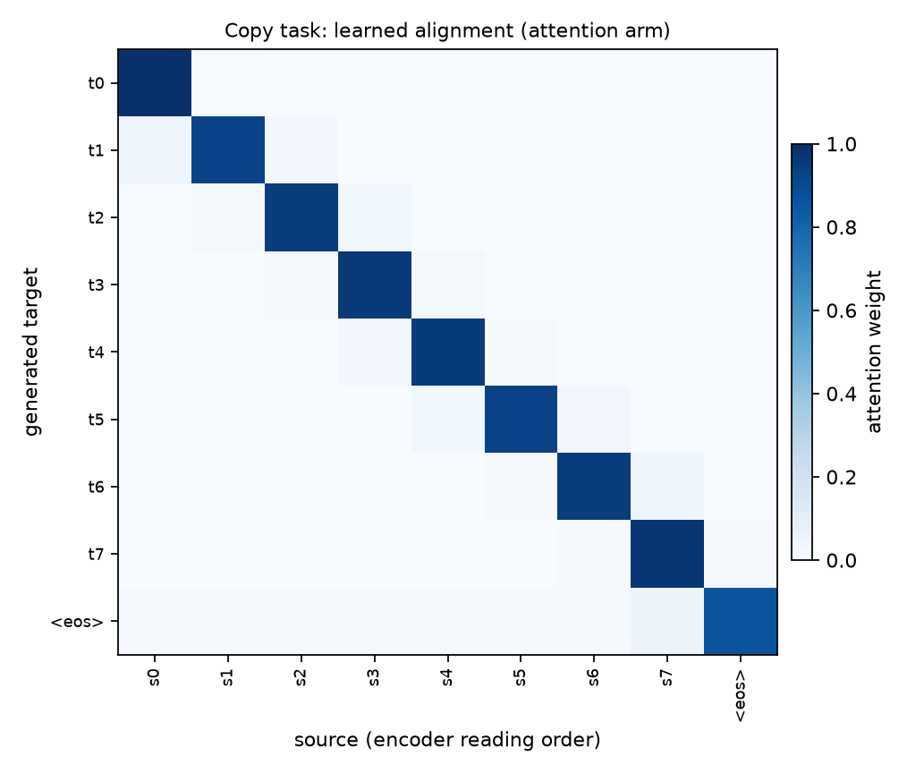
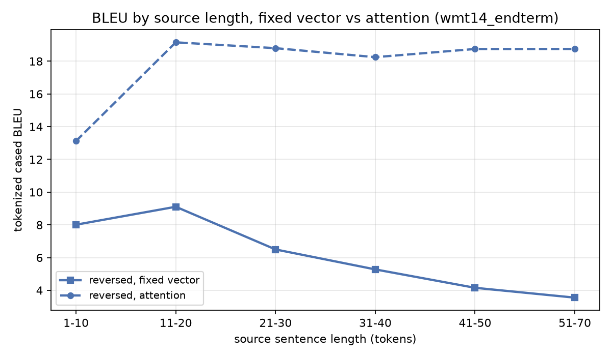
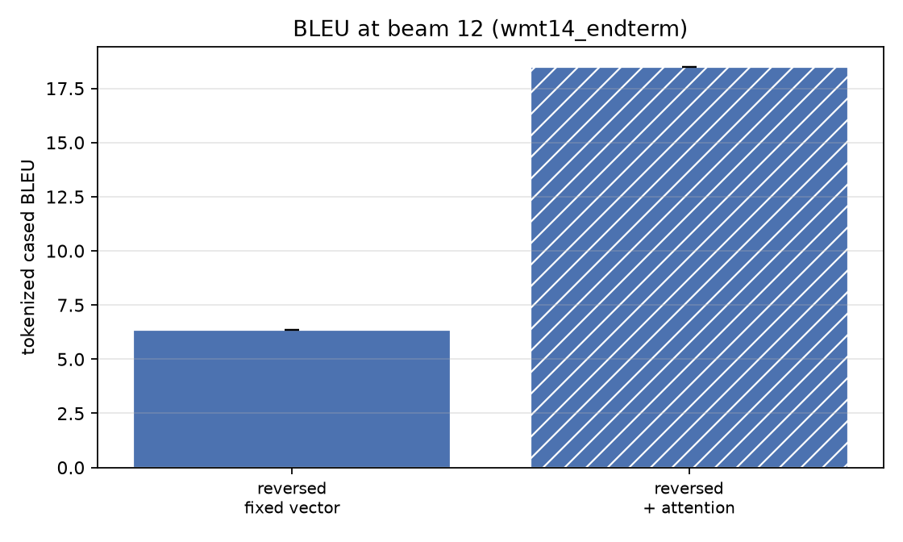
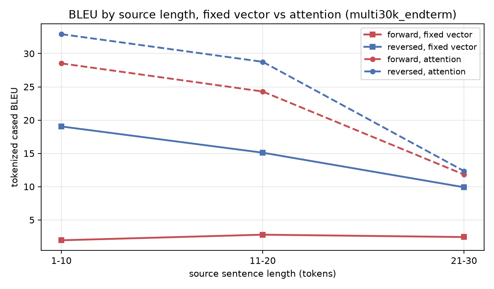
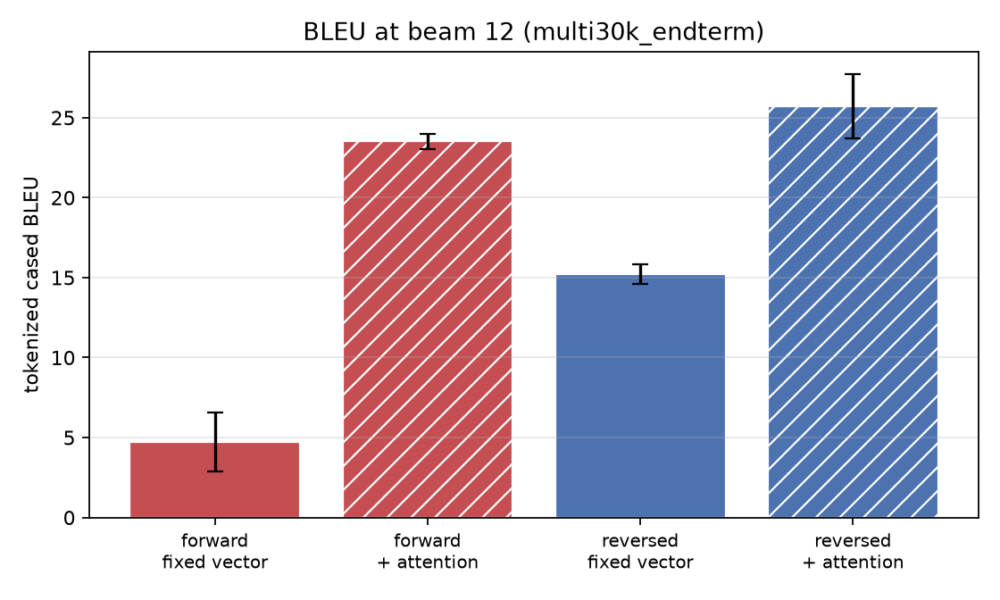
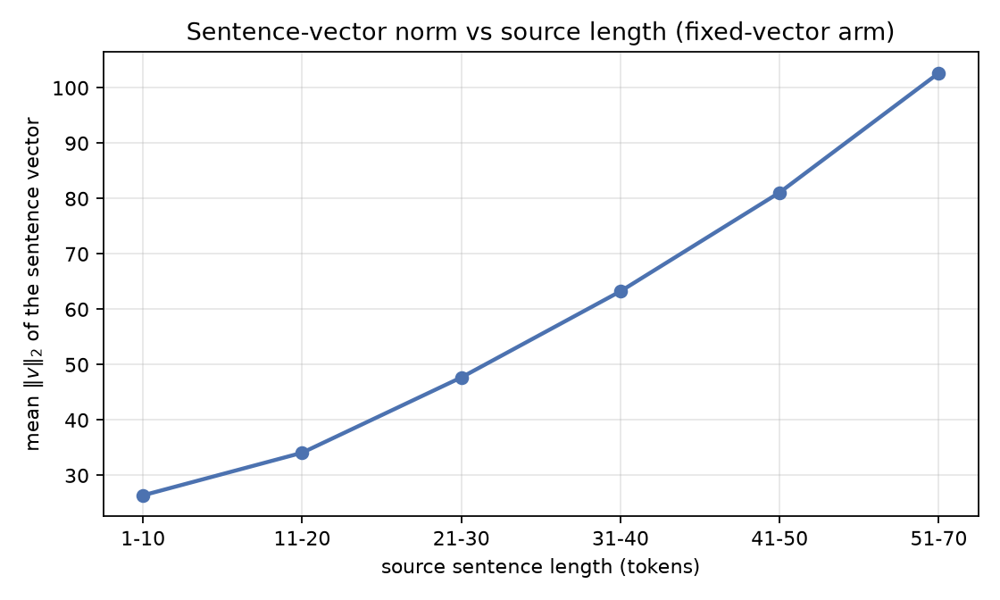
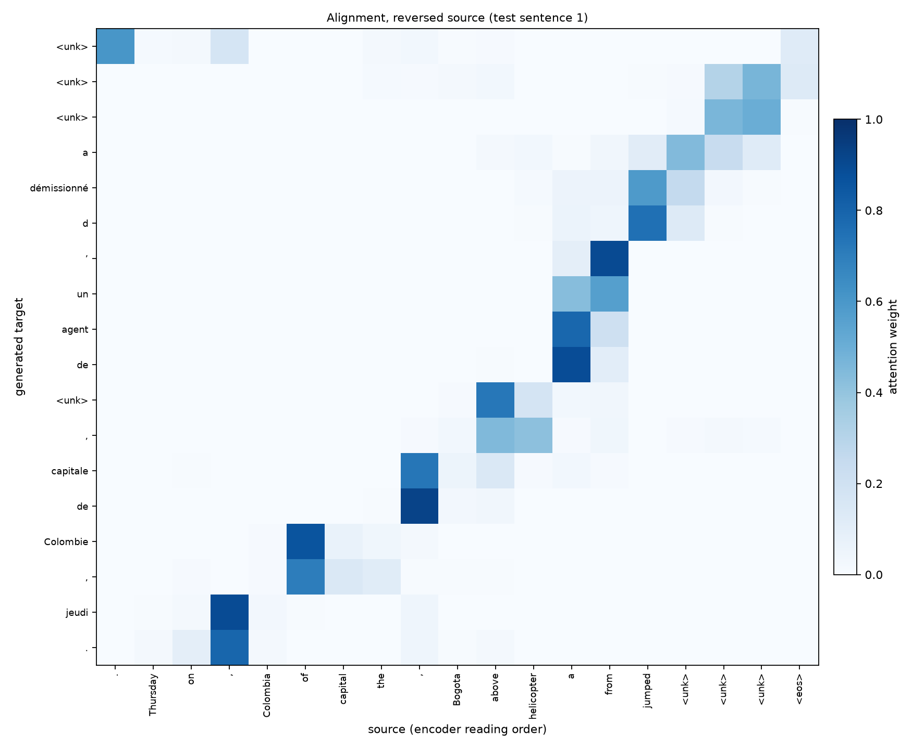
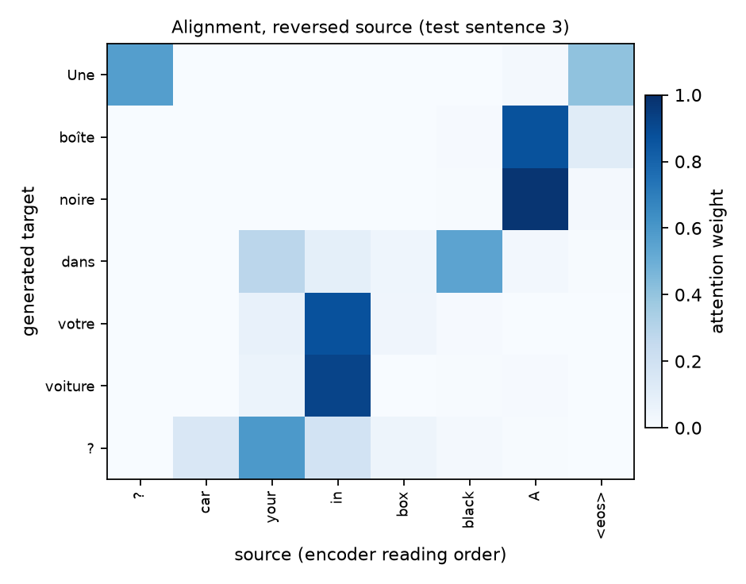
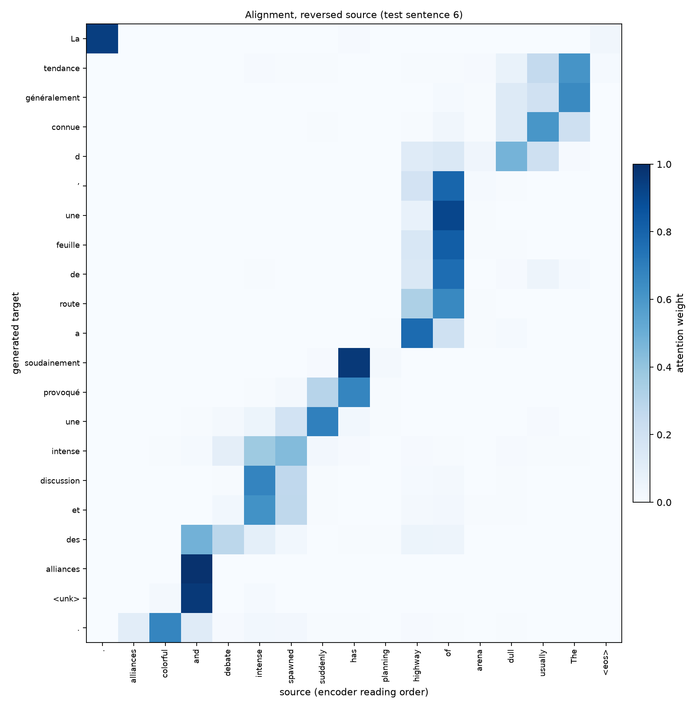

# Reproducing Sutskever et al. (2014), part II: the fixed-vector bottleneck

EE5180 end-term. Companion to `EE5180_midterm_report.pdf`, which reproduced
rows 3-4 of the paper's Table 1 (single forward vs single reversed LSTM).

## 1. The question

The mid-term's model reads a source sentence into one fixed-length vector and
then decodes from it. At our scale that vector is `num_layers x hidden x 2` =
2,048 real numbers (the paper's is 8,000). Every decoder step reads the same
vector, so the encoder has to decide what to keep *before* it knows what the
decoder will ask for, and a 60-token sentence gets exactly as much room as a
6-token one.

That is the bottleneck. The paper works around it rather than removing it: it
reverses the source so that the first words the decoder needs are the last the
encoder read, which shortens the minimal time lag between aligned words. Our
mid-term measured that trick working (WMT'14 BLEU 3.89 forward -> 6.60 reversed).

**Minimal time lag, and what backpropagation sees.** The term is Hochreiter &
Schmidhuber's, and it is the only explanation the paper offers -- it says so
explicitly ("we do not have a complete explanation for this phenomenon").
Counting recurrent steps between a source word *j* and the target step *t* that
needs it:

| | shortest pair | longest pair |
|---|---|---|
| forward source, fixed vector | *T* | *T + T'* |
| reversed source, fixed vector | **1** | *T + T'* |
| + attention, either direction | **1** | **1** |

Reversal changes no parameter, no training pair and no objective -- only *which*
pairs get the short path, which is why the average distance is unchanged. The
parameters at the far end of that path are the encoder's input and recurrent
weights and the source embeddings: reversed, they receive a strong and correctly
aligned gradient within the first few updates; forward, the same signal arrives
attenuated through *T + t* Jacobians. An LSTM makes a long lag survivable rather
than free, and gradient clipping is a separate mechanism (it bounds *exploding*
gradients, with the same threshold in both arms). Attention's context edge makes
the shortest and the longest path the same number, which is prediction 2 below
stated in gradients instead of in BLEU.

This half asks whether the fixed vector is the *binding* constraint, by removing
it: we implement **Bahdanau, Cho & Bengio (2015) additive attention** on the same
codebase and rerun the identical grid. If the bottleneck story is right, two
things should follow, and both are testable:

1. the fixed-vector model should lose ground **as sentences get longer**, and the
   attention model should not; and
2. **reversal should stop mattering** -- it exists to shorten a distance that
   attention removes outright.

## 2. The corpus: no length-mismatch filtering

The mid-term's data pipeline dropped training pairs whose source and target
lengths differed by more than a factor of 2.5, and dropped anything longer than
50 tokens. **The mismatch filter has been removed for the end-term** (it was
queried in review, and it is not defensible: a pair is not bad data because one
language says the same thing in fewer words). The length cap is also raised to
100, which matters more here than it did at mid-term -- long sentences are
exactly where a fixed-length vector is supposed to fail, so filtering them out
would have quietly removed the evidence.

| pairs dropped | mid-term (`ratio 2.5`, `len<=50`) | end-term (`ratio inf`, `len<=100`) |
|---|---|---|
| corpus read | 1,283,251 | 1,283,251 |
| empty line | 3,207 | 3,207 |
| over the length cap | 170,275 | 6,752 |
| **source/target length mismatch** | 1,823 | 0 |
| exact duplicate | 20,066 | 20,300 |
| kept | 1,087,880 | 1,252,992 |
| **subsampled for training** | **500,000** | **500,000** |

So 1,823 pairs are no longer discarded for a length mismatch and 163,523 are no longer discarded for
length. The drop report in `prepare_report.json` now records `"ratio": 0`, which
is the artefact to check rather than taking this paragraph's word for it.

Two deliberate choices in how this was done:

- **The training set is still exactly 500,000 pairs.** The corpus *size* is
  held fixed and only its length distribution moves (mean target length 26.07 ->
  30.80 tokens), so the arms differ in what sentences they see, not how many.
- **The mid-term pipeline is untouched.** `clean_pairs` keeps its old defaults and
  the old prepared directory still exists, so `make data-wmt` and `make results-wmt`
  still regenerate the submitted mid-term exactly. The new values are passed as
  flags into a separate directory.

**The baseline is retrained on this data.** Comparing attention-on-new-data with
no-attention-on-old-data would confound the architecture with the corpus, so the
no-attention arm is a fresh run. Both arms read one config file and differ only
in `--attention`.

## 3. What attention changes, and what is held fixed

The encoder keeps one annotation `h_j` per source position instead of only its
final state. At each decoder step the model scores every annotation against the
state it is about to update, and reads a weighted average:

```
e_tj = v^T tanh(W_enc h_j + W_dec s_{t-1})      additive (concat) energy
a_t  = softmax(e_t)                             over source positions, pad masked
c_t  = sum_j a_tj h_j                           the context for step t
s_t  = LSTM([E y_{t-1} ; c_t], s_{t-1})         context enters the recurrence
```

At `t = 0` the query `s_{t-1}` is the encoder's final top-layer state -- which is
exactly the baseline's sentence vector. Attention starts from the bottleneck and
is then allowed to look back, which is the cleanest possible framing of the
comparison.

**Held identical across the two arms**: corpus, vocabulary, seed, batch order and
length bucketing; plain SGD at 0.7 with no momentum; the halving schedule; the
summed-NLL-divided-by-batch-size loss convention and `clip_grad_norm_` at 5; the
`U(-0.08, 0.08)` initialisation, applied to the attention parameters too; beam
search and both BLEU conventions. `attention: bahdanau` is the only difference.

**Declared deviations specific to this arm:**

| deviation | why |
|---|---|
| tanh readout instead of the paper's maxout over `U_o s_i + V_o E y_{i-1} + C_o c_i` | All three terms are kept; only the maxout is replaced. tanh bounds the readout, so the output layer sees the same magnitudes as the baseline, the initial loss stays at ~ln&#124;V&#124;, and Sutskever's lr 0.7 / clip 5 transfer untouched. An unbounded readout would have needed its own tuning -- and then a BLEU gap between the arms could be an optimisation artefact instead of an architectural result. |
| unidirectional encoder (Bahdanau et al. use a BiRNN) | Adding bidirectionality at the same time as attention would confound the two. It is a separate flag, unused in the reported runs. |
| context enters the first decoder layer and the readout, not every layer | Bahdanau's decoder is single-layer, so any multi-layer placement is a deviation; this one measured no worse and keeps the fused multi-layer LSTM call. |

### Optimisation and batching

Both are the paper's, section 3.4, and neither was tuned for either arm -- a
learning rate chosen for the attention arm alone would let the BLEU gap be read
as an optimisation result rather than an architectural one.

| setting | paper sec. 3.4 | this project |
|---|---|---|
| optimiser | plain SGD, no momentum | identical |
| learning rate | 0.7 | 0.7 |
| schedule | constant 5 epochs, then halved every half epoch, 7.5 total | constant for the first two thirds, then 5 halvings, 8 total (`lr_constant_epochs 5.34`, `lr_halve_every 0.533`) |
| loss reduction | summed token NLL divided by **the batch size (128)** | identical |
| clipping | `s =` &#124;&#124;`g`&#124;&#124;`_2` on that divided gradient; if `s > 5`, `g <- 5g/s` | identical (`clip_grad_norm_(params, 5)`) |
| initialisation | `U(-0.08, 0.08)` | identical, attention parameters included |
| regularisation | none | none |

Dividing by 128 rather than by the token count is what keeps the threshold 5
meaning what it means in the paper; dividing by tokens would rescale the clip
with sentence length.

**Batching is length-bucketed, not random.** A random minibatch of 128 mixes
6-token and 100-token sentences, every short sentence is padded out to the
longest, and most of the arithmetic is spent on padding; the paper's fix is one
sentence long ("we made sure that all sentences in a minibatch are roughly of the
same length") and bought it a 2x speedup. `make_batches` shuffles the corpus,
sorts by `(source length + a small random integer, target length)`, cuts the
sorted index into contiguous batches of 128, then shuffles the *order* of the
batches. The noise is what makes each epoch's batches differ; a pure sort would
produce the same batches forever.

Two consequences worth stating. Padded shapes are rounded up to a multiple of 8 --
not for speed, but because Metal keeps an allocator block per distinct tensor
shape and bucketing otherwise produces dozens of shapes per epoch (this is the
same allocator creep that cost the mid-term a 7x throughput collapse). And
because the batches are built from one seed, **both arms see the same batches in
the same order**, which is what makes "one flag is the only difference" exact
rather than approximate.

The naive softmax over 32k words remains the memory ceiling -- at batch 128 and 51
target positions the logits tensor alone is 836 MB, and autograd keeps it for the
backward pass -- so the loss is computed in checkpointed chunks of 8 target
positions, which a gate asserts is numerically identical to the unchunked form.

### Cost

Measured with the same instrument as the mid-term (`make benchmark`), at the
end-term's shape on one M1 Pro GPU:

| arm | tgt-words/s | parameters | 8 epochs |
|---|---|---|---|
| fixed vector | 5,970 | 57.6M | 4.8 h |
| + attention | 5,045 | 59.9M | 5.7 h |

**1.18x slower for +3.6% parameters.** The per-step attention loop is ~3x slower
than one fused LSTM call in isolation, but the decoder is a small share of a
training step -- the 32k softmax dominates -- so it dilutes to 1.18x end to end.
The small parameter delta is part of the argument: the arms' BLEU gap cannot be
attributed to extra capacity.

## 4. Correctness, before any result

Adding attention meant changing the encoder (it now also returns its
per-position outputs) and beam search (survivor reindexing now carries the
encoder memory bank). Both touch the code that produced the submitted mid-term,
so the first thing built was the gate that says whether they moved it.

**`make baseline-regression`** re-decodes the submitted mid-term checkpoints and
`diff`s the hypotheses against the committed files. Decoding is deterministic, so
the diff must be *empty* -- a much sharper statement than "BLEU still rounds to
6.60". It is empty, on all 3,003 sentences of newstest2014, for both directions.

`tests/` carries 52 gates (23 from the mid-term, unchanged and still passing, plus
29 new). The ones worth naming:

- **alignments are a masked distribution**: weights sum to 1 and are *exactly* 0
  on padding. `collate` pads the source width up to a multiple of 8, so padding is
  always present and an unmasked softmax would hand probability mass to `<pad>`.
- **teacher-forced training and step-by-step decoding agree to 1e-6**. If the
  attention query were taken from `s_t` instead of `s_{t-1}`, both paths would
  still run and still train, and they would silently disagree -- training would
  optimise a model that decoding does not implement.
- **beam(B=1) is exactly greedy decoding** for the attention arm as well.
- **MPS and CPU agree on loss and every gradient to 1e-3**. Attention adds `bmm`,
  a `-inf`-masked softmax and a 3-D `tanh` to the Metal path, and the mid-term
  already had to guard against silently wrong Metal LSTM kernels.
- **the encoder's annotations keep the collated width**, not `max(src_len)`.
  `pad_packed_sequence` returns the shorter width by default, which would
  un-quantise the tensor shapes and reintroduce the allocator creep that cost the
  mid-term a 7x throughput collapse.

### The evidence ledger

This is a reproduction project, so the artefacts are part of the result. What
a reader can check without a GPU:

| what | how much |
|---|---|
| implementation, written from the two papers' text | **1,766 lines** across 11 modules, no reference repository |
| the pieces the argument rests on | `attention.py` 63 lines, `model.py` 357 lines, `beam.py` 162 lines, `data.py` 281 lines |
| decoded hypotheses committed (WMT'14) | **18,018 sentences** in 6 files -- both arms x beam 1/2/12, tokenised and detokenised, each with its eval JSON |
| regeneration | **30 make targets**; every table and figure below has one |

`attention.py` being short is the point rather than an apology: the mechanism
can be read against Bahdanau's four equations in a minute, which is the only
way a reader can confirm that what we call attention is attention. Checkpoints
are excluded for size; everything else -- the drop report, both WMT'14 arms, the
12 Multi30k runs, the probes, the alignments and the copy task -- is committed
under `results/`.

### The bottleneck in miniature

Before spending a night on WMT, the same claim on a task with no confounds:
target == source over uniformly random tokens. Nothing is memorisable and there
is no language model to lean on, so emitting position *t* requires reading source
position *t*.

| arm | final loss / sequence | fraction of chance (28.6) |
|---|---|---|
| fixed vector | **4.875** | 17% |
| + attention | **0.004** | 0.0% |

Alignment spread reached 0.9989 (1.0 = fully peaked), and the
learned alignment is the exact diagonal.
The fixed-vector arm cannot solve a task that is purely about reading the right
source position; attention solves it and shows exactly where it read.



Optimiser: Adam, a controlled demonstration rather than a reported reproduction
(the paper's SGD at 0.7 needs far longer to leave chance on a model this small).

## 5. Results -- wmt14_endterm

WMT'14 En-Fr, 500k pairs, 2x512, scored on the paper's own newstest2014 (3,003 sentences).


> **Scale gap.** 0.5M pairs vs the paper's 12M; 2x512 vs 4x1000; 32k/32k vocab vs 160k/80k. Prepared with NO length-mismatch filtering and a 100-token cap. Absolute BLEU is NOT comparable to Table 1 - the direction and shape of the effects are.

The two arms share their corpus, vocabulary, seed, batch order, optimiser,
learning-rate schedule and gradient clipping. `attention: bahdanau` is the
only difference between them.

| direction | arm | beam | BLEU (tok, cased) | BLEU (detok) | test ppl | params | runs |
|---|---|---|---|---|---|---|---|
| reversed | fixed vector | 12 | **6.36** | 4.62 | 24.067 | 57.6M | 1 |
| reversed | + attention | 12 | **18.49** | 14.99 | 10.690 | 59.9M | 1 |

## What the arms say about the bottleneck

- reversed: fixed vector **6.36** -> attention **18.49** (**+12.13** BLEU).

### The shape of the length curve

This is the actual bottleneck claim: a single fixed vector should lose ground
as the source grows, and attention should not.

| source length | sentences | fixed vector | + attention | gain |
|---|---|---|---|---|
| 1-10 | 405 | 8.01 | 13.12 | **+5.11** |
| 11-20 | 954 | 9.11 | 19.15 | **+10.05** |
| 21-30 | 832 | 6.50 | 18.80 | **+12.30** |
| 31-40 | 535 | 5.28 | 18.25 | **+12.97** |
| 41-50 | 194 | 4.15 | 18.75 | **+14.59** |
| 51-70 | 80 | 3.55 | 18.75 | **+15.20** |

- Fixed vector, 1-10 -> 51-70: 8.01 -> 3.55 (-4.46).
- Attention,    1-10 -> 51-70: 13.12 -> 18.75 (+5.63).

The gain widens with source length (+5.11 at 1-10 -> +15.20 at 51-70), which is the bottleneck claim: the longer the source, the more a single fixed vector costs.

Treat the `51-70` row with care: it is 80 sentences, so its BLEU is noisy and the slope above rests largely on it.

## Figures






### Beam width: what the search buys, and what it costs

Decoding is the paper's: at each step every one of the `B` partial hypotheses is
extended by every vocabulary word, the candidates are ranked by **raw**
log-probability with **no length normalisation**, the best `B` survive, and a
hypothesis that emits `<eos>` retires into the completed set, so the beam
genuinely shrinks. `length_norm` exists as a flag and is `0.0` in every number
reported here. `B = 1` reduces exactly to greedy decoding, which `tests/` asserts
for both arms.

Because the ranking is a raw log-probability, every extra token lowers a
hypothesis's score, so a wider beam is biased towards shorter output. Counting
tokens in the committed hypothesis files over all 3,003 test sentences:

| B | fixed: mean hyp. length | BLEU | + attention: mean hyp. length | BLEU |
|---|---|---|---|---|
| 1 | 26.98 | 6.56 | 26.57 | 17.40 |
| 2 | 26.53 | 6.82 | 26.41 | 18.45 |
| 12 | 26.08 | 6.36 | 25.78 | 18.49 |

**Both arms shorten, and only one of them pays for it.** Going from B = 1 to B = 12
costs the fixed-vector arm 0.90 tokens of mean length (3.3%) and the attention arm 0.80 (3.0%);
beam 12 returns a shorter hypothesis than beam 1 on 1,566 of the baseline's sentences and 1,402 of the attention arm's.
So the shortening is a property of the ranking rule, not of either model --
yet the baseline's BLEU peaks at B = 2 and falls, while the attention arm's is
monotone. What differs is what the extra hypotheses *are*: under weak
fixed-vector conditioning the likelier-but-shorter candidates are worse
translations and the brevity penalty collects them. The mid-term decomposed the
same effect on its own corpus (length ratio 0.979 -> 0.967 -> 0.945, 4-gram
precision *rising* while BLEU falls, and length normalisation overshooting to
1.143 and lowering BLEU further, 6.60 -> 6.07). That the effect disappears when
the fixed vector does is itself evidence that it was a symptom of the
bottleneck rather than of the beam code.

One sentence, to make the mechanism concrete:

| | newstest2014 line 397, attention arm |
|---|---|
| **source** | I don't know who it was that said that those who die are not forgotten but invisible. |
| **B = 1** | Je ne sais pas qui a déclaré que ceux qui meurent de faim n'étaient pas oubliés mais &lt;unk&gt;. |
| **B = 2** | Je ne sais pas qui a déclaré que ceux qui meurent de faim n'ont pas été oubliés, mais &lt;unk&gt;. |
| **B = 12** | Je ne sais pas qui a déclaré que ceux qui meurent ne sont pas oubliés, mais &lt;unk&gt;. |
| **reference** | Je ne sais plus qui disait que les personnes décédées ne sont pas des oubliés mais des invisibles. |

Greedy takes `de` after `meurent` because it is the likeliest single next
token, and the clause is then committed to *died of hunger*, which is not what
the source says. A beam of 12 keeps the competing continuation alive long
enough for the clause to recover. Nothing about the model changed between the
three rows -- only how much of its own distribution the decoder kept open.


## 6. Results -- multi30k_endterm

Multi30k, 29k image captions, 2x256, 3 seeds -- not the paper's corpus or test set, but the only tier where we can afford error bars and the full 2x2 grid.


> **Scale gap.** Multi30k (29k image captions), 2x256. Prepared with NO length-mismatch filtering. Pipeline validation plus the seed-controlled {forward,reversed} x {fixed vector, attention} grid - NOT the paper's corpus or test set.

The two arms share their corpus, vocabulary, seed, batch order, optimiser,
learning-rate schedule and gradient clipping. `attention: bahdanau` is the
only difference between them.

| direction | arm | beam | BLEU (tok, cased) | BLEU (detok) | test ppl | params | runs |
|---|---|---|---|---|---|---|---|
| forward | fixed vector | 12 | **4.72** ± 1.83 | 4.38 | 13.839 | 9.8M | 3 |
| forward | + attention | 12 | **23.51** ± 0.46 | 22.79 | 6.353 | 10.4M | 3 |
| reversed | fixed vector | 12 | **15.21** ± 0.63 | 14.85 | 9.048 | 9.8M | 3 |
| reversed | + attention | 12 | **25.73** ± 2.00 | 24.95 | 5.989 | 10.4M | 3 |

## What the arms say about the bottleneck

- reversed: fixed vector **15.21** -> attention **25.73** (**+10.52** BLEU).
- forward: fixed vector **4.72** -> attention **23.51** (**+18.80** BLEU).

- The reversal gap (reversed minus forward) is **+10.49** without attention and **+2.21** with it.
  Attention absorbs 79% of it. That is the paper's trick being made redundant: reversing the source shortens the distance between a source word and the decoder step that needs it, and attention removes the distance altogether.

### The shape of the length curve

This is the actual bottleneck claim: a single fixed vector should lose ground
as the source grows, and attention should not.

| source length | sentences | fixed vector | + attention | gain |
|---|---|---|---|---|
| 1-10 | 287 | 19.05 | 32.92 | **+13.87** |
| 11-20 | 659 | 15.11 | 28.76 | **+13.66** |
| 21-30 | 52 | 9.91 | 12.35 | **+2.43** |

- Fixed vector, 1-10 -> 21-30: 19.05 -> 9.91 (-9.13).
- Attention,    1-10 -> 21-30: 32.92 -> 12.35 (-20.57).

**The gain does NOT widen with source length** (+13.87 at 1-10 -> +2.43 at 21-30), and the attention arm falls off at least as fast as the fixed-vector arm (-20.57 vs -9.13). At this scale and on this corpus the length curve does NOT evidence the bottleneck; the arm-level gain above is real, but it is not explained by source length.

Treat the `21-30` row with care: it is 52 sentences, so its BLEU is noisy and the slope above rests largely on it.

## Figures






## 7. The bottleneck without BLEU

BLEU is a beam-mediated, n-gram view of a model. Two sharper probes, with no
beam search in them at all.

### Per-token perplexity by source length

| source length | n | fixed vector | + attention | ratio |
|---|---|---|---|---|
| 1-10 | 405 | 20.428 | 13.270 | 0.650 |
| 11-20 | 954 | 17.785 | 9.572 | 0.538 |
| 21-30 | 832 | 21.662 | 9.949 | 0.459 |
| 31-40 | 535 | 27.956 | 11.270 | 0.403 |
| 41-50 | 194 | 32.970 | 11.604 | 0.352 |
| 51-70 | 80 | 39.158 | 12.674 | 0.324 |

A ratio that *falls* across the buckets means attention helps more on long
sentences -- the bottleneck claim stated in the model's own likelihood.

### Sentence-vector saturation

The fixed vector is 2,048 real numbers and
carries the whole source sentence however long it is.

| source length | n | mean &#124;&#124;v&#124;&#124; |
|---|---|---|
| 1-10 | 405 | 26.3991 |
| 11-20 | 954 | 34.0908 |
| 21-30 | 832 | 47.6918 |
| 31-40 | 535 | 63.2498 |
| 41-50 | 194 | 81.0987 |
| 51-70 | 80 | 102.6732 |



## 8. What the model reads (Bahdanau Fig. 3 analogue)

**Which figure this is an analogue of.** Sutskever et al. contains no attention
figure -- attention appears in that paper in a single sentence of related work,
crediting Graves (2013) for the mechanism and Bahdanau et al. for applying it to
translation, and that sentence is the gap this half of the project fills. The
figures below answer to **Bahdanau et al.**: their Figure 1 draws the mechanism
(one annotation per source position, all of them feeding a weighted sum into the
single decoder state, with edge thickness standing for `a_tj`), and their Figure 3
plots `a` as a greyscale matrix with the target down one axis and the source
across the other. The panel of theirs that is usually quoted is *the European
Economic Area* -> *la zone economique europeenne*, where the alignment **crosses**:
the last three source words are read in reverse, because French puts the noun
first. That is the thing a monotone decoder cannot express at all, and the thing
a distortion-limited phrase-based decoder can only express inside its reordering
window (section 9).

Alignments over the model's **own** output, not the reference. The source axis
is in **encoder reading order** -- for a reversed model that is right-to-left, so
a faithful word-by-word alignment appears as an anti-diagonal. We label it that
way rather than un-reversing the axis to make a prettier picture. The local
departures from that anti-diagonal are reorderings, and nothing supervised them:
the only training signal was the next French word.

**Source**  <unk> <unk> <unk> jumped from a helicopter above Bogota , the capital of Colombia , on Thursday .

**Ours**    <unk> <unk> <unk> a démissionné d ’ un agent de <unk> , capitale de Colombie , jeudi .



---

**Source**  A black box in your car ?

**Ours**    Une boîte noire dans votre voiture ?



---

**Source**  The usually dull arena of highway planning has suddenly spawned intense debate and colorful alliances .

**Ours**    La tendance généralement connue d ’ une feuille de route a soudainement provoqué une intense discussion et des alliances <unk> .



---

## 9. Before the LSTM: phrase-based SMT, reordering, and rescoring

Both of the paper's headline comparisons are against a system this report has so
far only named, and two of its claims are about ranking rather than translating.
Both matter for reading Table 1 and Table 2 correctly.

**What the 33.30 baseline is.** Not a neural model: a phrase-based statistical
machine translation pipeline (the WMT'14 baseline, reference 29 of the paper, the
same source as the 1000-best lists). Its parts are a **phrase table** extracted
from word-aligned bitext; a **log-linear** scoring model combining phrase
translation probabilities in both directions, lexical weights, an **n-gram target
language model**, word and phrase penalties and a **distortion (reordering)
model**; feature weights tuned on a development set; and a stack decoder that
searches over which source words have been covered. Its vocabulary is unlimited --
it never emits `<unk>`, which is the handicap the LSTM carries throughout.

**Reordering is the part that constrains it.** A phrase table is local: it says
how to translate a fragment, not where to put it, so target word order has to come
from **permuting phrases**. Each permutation is charged by the distortion model --
a plain one scores the jump `|b_i - e_{i-1} - 1|` between consecutive phrases, and
lexicalised variants learn a monotone / swap / discontinuous orientation per
phrase -- and because searching all permutations is intractable, decoders impose a
**reordering limit**, typically around six words. Short, local reorderings are
therefore cheap and long-range ones lie outside the search window: noun-adjective
inversion is reachable, a verb crossing a clause is not.

**The LSTM has no such model, and that cuts both ways.** There is no alignment
model, no phrase table, no distortion term and no reordering limit; word order
lives entirely in the decoder's hidden state. That is why it can in principle
reorder arbitrarily, and also why it needed the source reversed before it could
learn the correspondence at all (section 1). Attention makes the permutation
explicit again but **learned and unbounded**: `a_t` can place its mass anywhere in
the source at no extra cost, which is what the crossing alignments of section 8
are. Read in that order, source reversal and attention are two answers to the same
question SMT answered with a distortion model.

**How the comparison actually lands**, stated without rounding in our favour:

| system, newstest2014 (paper's numbers) | BLEU |
|---|---|
| phrase-based SMT baseline | 33.30 |
| single reversed LSTM, beam 12 | 30.59 (**loses**) |
| ensemble of 5 reversed LSTMs, beam 12 | **34.81** |
| rescoring the baseline's 1000-best with that ensemble | 36.50 |
| best WMT'14 system | 37.00 |

A single LSTM is *worse* than the pipeline. The paper's claim rests on the
ensemble, and it is a claim about what the LSTM carried -- none of SMT's
components, a capped vocabulary, a penalty on every out-of-vocabulary word -- not
about being the best system on the task.

**Rescoring (Table 2), and why ranking scores higher than generating.** The method
is four steps: take the baseline's published 1000 best hypotheses for a sentence;
compute `log p(T|S)` for each under the LSTM, teacher-forced, with nothing
generated and nothing searched; take an **even average** of that with the
hypothesis's own baseline score, with no tuned weights; re-rank and emit the top.
That yields 35.61 (single forward), 35.85 (single reversed) and 36.50 (ensemble of
5), against the same models' 34.81 by direct decoding.

The asymmetry is worth being precise about, because it is the difference between
the two uses of a language model in translation. Beam search makes the model
**generate**: it must produce every word itself, inside its own vocabulary,
exposed to its own search errors and to the length bias quantified in section 5.
Rescoring asks it only to **rank** sentences another system produced: it never has
to spell a word it does not know, the candidate list already carries SMT's
unlimited vocabulary and its reordering, and the model is used only where it is
strongest, as a whole-sentence judge. But ranking is bounded by someone else's
candidate set -- the oracle over the same 1000-best lists is about 45 BLEU, so even
a perfect ranker stops there. That ceiling is why direct decoding at 34.81 was the
more consequential result even at the lower score: it is the number that does not
need the pipeline.

**We do not run Table 2**, and section 11 says so. Those lists belong to a
12M-pair baseline with an unlimited vocabulary; a 32k-vocabulary model trained on
1/24 of the data would map a large share of their hypotheses' words to `<unk>`, so
the resulting number would measure our vocabulary rather than our model. The
analogue we do have moves the same combination idea *inside* the search:
ensembling averages per-step log-probabilities across models, a geometric mean of
their distributions rather than an even average of final scores.

## 10. From attention to the Transformer

This is the line the topic asks us to trace, and the experiment above is the
first step on it.

**Attention began as a patch and turned out to be the mechanism.** Bahdanau et al.
added attention *to* a recurrent encoder-decoder; the recurrence was still what
built the representations and attention only chose among them. But attention has a
property the recurrence does not: the path between any source position and any
target step is **constant length**. The recurrence's path grows with distance,
which is the whole reason Sutskever et al. had to reverse the source -- reversal
shortens the lag for the early words at the cost of the late ones. Attention makes
the trick unnecessary, which is the prediction we test in sections 5-6.

**If attention is doing the work, why keep the recurrence?** Its remaining job was
to give each position a context-dependent representation. But attention can do
that too, by letting a sequence attend to *itself* -- self-attention. Dropping the
recurrence then buys something the LSTM can never give: the timesteps stop being
sequentially dependent, so a whole sentence is one batched matrix multiply instead
of *T* dependent steps. That is exactly the cost we paid in this project and
measured: our attention decoder is ~3x slower than the baseline's single fused
LSTM call *precisely because* the context enters the recurrence and forces a
per-timestep loop. Vaswani et al. (2017) remove the recurrence and the loop goes
with it.

**What else had to change, and why.** Three gaps had to be closed before
"attention only" could work:

- *Order.* A set of vectors attending to each other has no notion of sequence,
  which the recurrence had supplied for free. Hence positional encodings.
- *Capacity per layer.* One attention distribution per step can only express one
  alignment; syntax needs several relations at once. Hence multiple heads.
- *Scale.* The additive energy we implement here needs a `(B, T, S, A)` tensor to
  score all pairs at once -- at our batch and 104 tokens that is a single 2.8 GB
  allocation, which we measured driving this machine into swap. The scaled
  dot-product energy `QK^T / sqrt(d)` needs no such tensor: it is two matrix
  multiplies. The move from Bahdanau's additive score to a dot-product score is
  not cosmetic; it is what makes all-pairs attention affordable.

So the line runs: *fixed vector* (Sutskever 2014, our mid-term) -> *attention over
annotations, recurrence retained* (Bahdanau 2015, this report) -> *attention over
everything, recurrence removed* (Vaswani 2017) -> the decoder-only language models
that current machine translation is a special case of. Each step removes a
constraint the previous one had worked around, and the bottleneck measured here is
the first of them.

We do not claim to have tested the Transformer step; the self-attention run is
named as future work in the mid-term plan and stayed out of scope. What the runs
above support is the first arrow only.

## 11. What we claim, and what we do not

- **We do not claim comparable BLEU.** 500k pairs against the paper's 12M, 2x512
  against 4x1000, 32k/32k vocabulary against 160k/80k, one laptop GPU against 8
  GPUs for 10 days. Our absolute numbers are far below Table 1 and we never print
  one without that caveat beside it.
- **We claim the direction and the shape** of the effects: whether the fixed-vector
  arm degrades with source length and the attention arm does not, and whether the
  reversal gap shrinks when attention is present.
- **The comparison is controlled.** The two arms share everything but one flag, the
  parameter difference is 3.6%, and the baseline was retrained on the same corpus.
- **The mid-term is untouched.** Its hypotheses re-decode byte-identically.
- **Negative results are reported.** The mid-term's beam trend did not reproduce and
  we said so; anything here that fails to reproduce is reported the same way.
- **Not attempted, by design**: the Transformer step (explained and motivated from
  our own measurements in section 10, never run); the paper's 384M-parameter
  4x1000 configuration; Table 2's rescoring of the SMT 1000-best lists (section 9
  gives the reason); and a bidirectional encoder, which exists as a flag and is
  deliberately unused so that it cannot confound attention.

