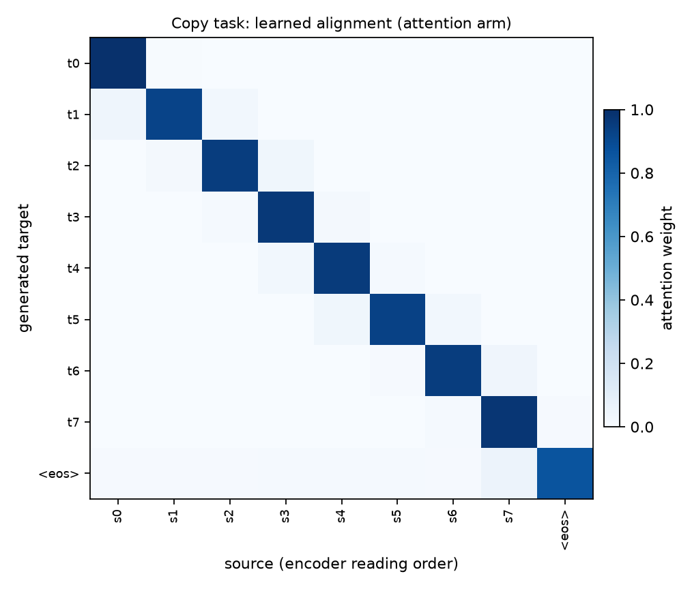

# The bottleneck in miniature: a copy task

Target == source over uniformly random tokens. Nothing is memorisable and
there is no language model to lean on, so emitting target position *t*
requires reading source position *t*. The only difference between the two
arms is attention.

| arm | final loss / sequence | vs chance (28.6) |
|---|---|---|
| fixed vector (the paper's model) | **4.875** | 17% |
| + Bahdanau attention | **0.004** | 0% |

Alignment spread reached **0.9989** (1.0 = fully peaked); the learned alignment is the exact diagonal.

Optimiser: Adam, lr 0.003 -- a controlled demonstration, not a reported reproduction. Plain SGD at the paper's lr 0.7 needs far more than 1500 steps to leave chance on a 64-unit model.
