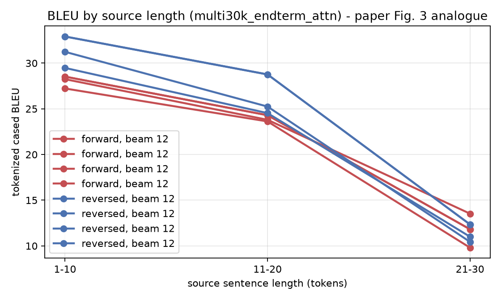
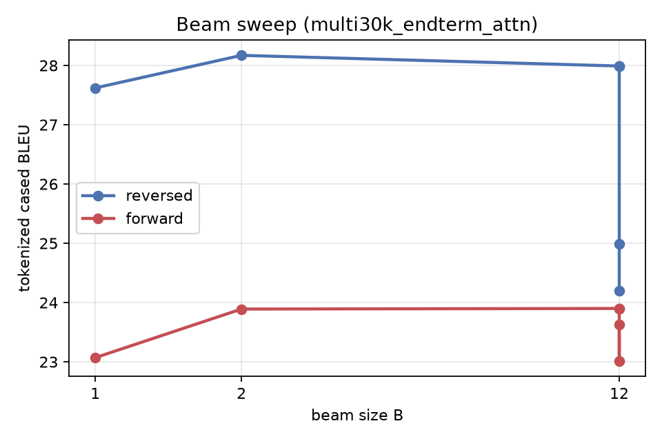
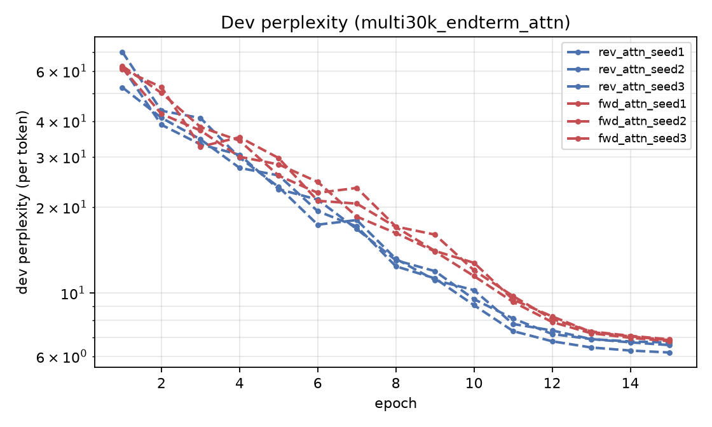

# Reproduction results - multi30k_endterm_attn

> **Scale gap.** Multi30k (29k image captions), 2x256. Prepared with NO length-mismatch filtering. Pipeline validation plus the seed-controlled {forward,reversed} x {fixed vector, attention} grid - NOT the paper's corpus or test set.

| Method | beam | our BLEU (tok, cased) | our BLEU (sacreBLEU detok) | our test ppl | paper BLEU |
|---|---|---|---|---|---|
| Single forward LSTM | 1 | **23.07** | 21.98 | 6.282 | - |
| Single forward LSTM | 2 | **23.89** | 23.06 | 6.282 | - |
| Single forward LSTM | 12 | **23.90** | 23.17 | 6.282 | 26.17 |
| Single forward LSTM | 12 | **23.90** | 23.17 | 6.282 | 26.17 |
| Single forward LSTM | 12 | **23.01** | 22.36 | 6.372 | 26.17 |
| Single forward LSTM | 12 | **23.63** | 22.84 | 6.405 | 26.17 |
| Ensemble of 3 forward LSTM | 1 | **24.82** | 23.95 | - | - |
| Ensemble of 3 forward LSTM | 2 | **25.86** | 25.15 | - | - |
| Ensemble of 3 forward LSTM | 12 | **25.83** | 25.07 | - | - |
| Single reversed LSTM | 1 | **27.62** | 26.20 | 5.677 | - |
| Single reversed LSTM | 2 | **28.17** | 27.23 | 5.677 | - |
| Single reversed LSTM | 12 | **27.99** | 27.16 | 5.677 | 30.59 |
| Single reversed LSTM | 12 | **27.99** | 27.16 | 5.677 | 30.59 |
| Single reversed LSTM | 12 | **24.99** | 24.33 | 6.067 | 30.59 |
| Single reversed LSTM | 12 | **24.20** | 23.36 | 6.223 | 30.59 |
| Ensemble of 3 reversed LSTM | 1 | **29.13** | 28.03 | - | - |
| Ensemble of 3 reversed LSTM | 2 | **30.04** | 29.08 | - | - |
| Ensemble of 3 reversed LSTM | 12 | **29.52** | 28.65 | - | - |

## The paper's central claim, at our scale

- BLEU (beam 12): forward **23.63** -> reversed **24.20** (**+0.57**); paper 26.17 -> 30.59 (+4.42).
- Test perplexity: forward **6.405** -> reversed **6.223**; paper 5.8 -> 4.7.
- Beam: B=1 27.62, B=2 28.17, B=12 24.20 - BLEU peaks at B=2 and falls by 3.97 at B=12, so the paper's monotone beam trend does NOT reproduce at our scale. A wider beam does find higher-probability hypotheses, but they are worse translations. Length normalisation removes the brevity penalty and makes BLEU worse still, so brevity is a symptom rather than the cause - see beam_ablation.md for the decomposition.

## Figures

## Scoring signatures

- tokenized (multi-bleu.pl equivalent): `nrefs:1|case:mixed|eff:no|tok:none|smooth:exp|version:2.6.0`
- detokenized sacreBLEU: `nrefs:1|case:mixed|eff:no|tok:13a|smooth:exp|version:2.6.0`
