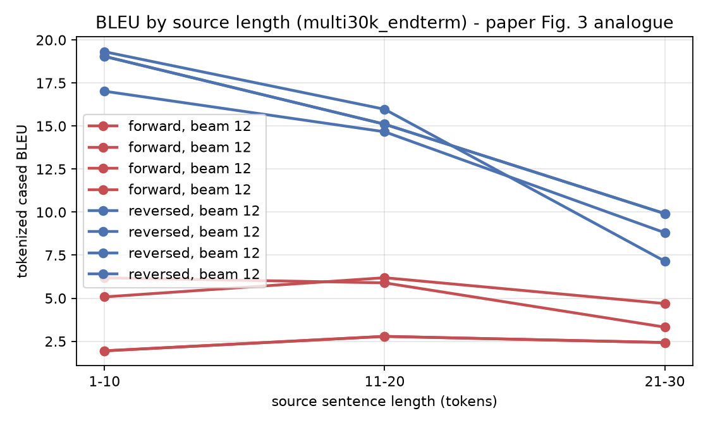
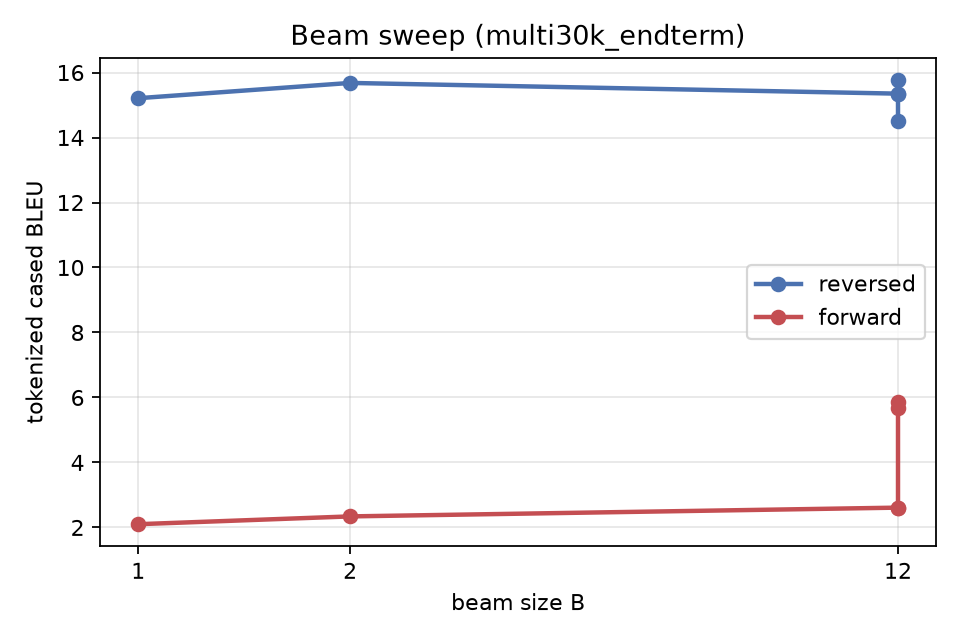
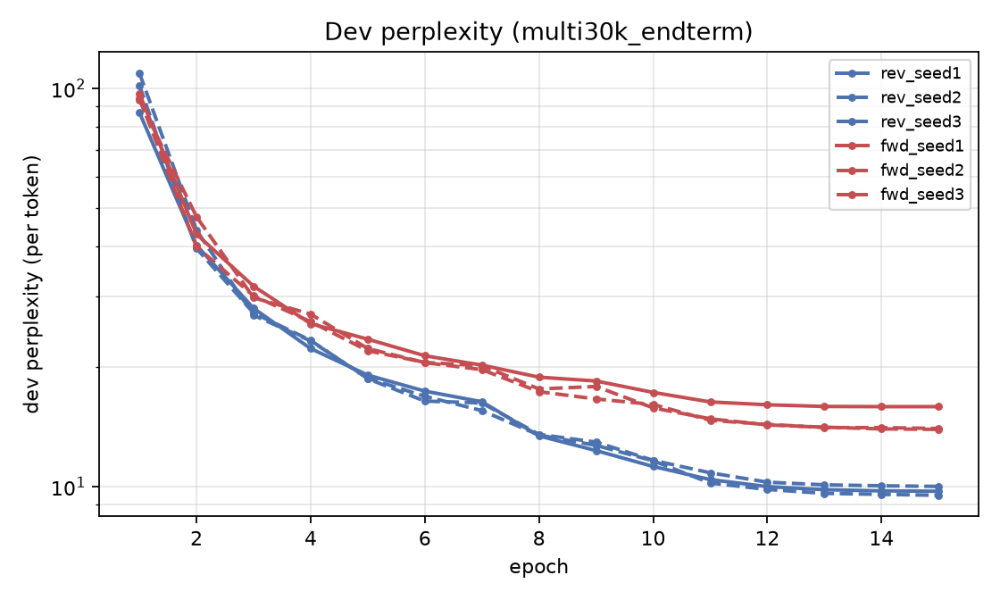

# Reproduction results - multi30k_endterm

> **Scale gap.** Multi30k (29k image captions), 2x256. Prepared with NO length-mismatch filtering. Pipeline validation plus the seed-controlled {forward,reversed} x {fixed vector, attention} grid - NOT the paper's corpus or test set.

| Method | beam | our BLEU (tok, cased) | our BLEU (sacreBLEU detok) | our test ppl | paper BLEU |
|---|---|---|---|---|---|
| Single forward LSTM | 1 | **2.10** | 2.16 | 15.103 | - |
| Single forward LSTM | 2 | **2.34** | 2.26 | 15.103 | - |
| Single forward LSTM | 12 | **2.61** | 2.26 | 15.103 | 26.17 |
| Single forward LSTM | 12 | **2.61** | 2.26 | 15.103 | 26.17 |
| Single forward LSTM | 12 | **5.85** | 5.46 | 13.199 | 26.17 |
| Single forward LSTM | 12 | **5.69** | 5.42 | 13.214 | 26.17 |
| Ensemble of 3 forward LSTM | 1 | **5.89** | 5.90 | - | - |
| Ensemble of 3 forward LSTM | 2 | **6.45** | 6.39 | - | - |
| Ensemble of 3 forward LSTM | 12 | **5.62** | 5.35 | - | - |
| Single reversed LSTM | 1 | **15.21** | 14.76 | 9.014 | - |
| Single reversed LSTM | 2 | **15.68** | 15.26 | 9.014 | - |
| Single reversed LSTM | 12 | **15.35** | 14.96 | 9.014 | 30.59 |
| Single reversed LSTM | 12 | **15.35** | 14.96 | 9.014 | 30.59 |
| Single reversed LSTM | 12 | **15.76** | 15.40 | 8.944 | 30.59 |
| Single reversed LSTM | 12 | **14.52** | 14.20 | 9.185 | 30.59 |
| Ensemble of 3 reversed LSTM | 1 | **17.69** | 17.17 | - | - |
| Ensemble of 3 reversed LSTM | 2 | **18.32** | 17.87 | - | - |
| Ensemble of 3 reversed LSTM | 12 | **17.96** | 17.53 | - | - |

## The paper's central claim, at our scale

- BLEU (beam 12): forward **5.69** -> reversed **14.52** (**+8.83**); paper 26.17 -> 30.59 (+4.42).
- Test perplexity: forward **13.214** -> reversed **9.185**; paper 5.8 -> 4.7.
- Beam: B=1 15.21, B=2 15.68, B=12 14.52 - BLEU peaks at B=2 and falls by 1.16 at B=12, so the paper's monotone beam trend does NOT reproduce at our scale. A wider beam does find higher-probability hypotheses, but they are worse translations. Length normalisation removes the brevity penalty and makes BLEU worse still, so brevity is a symptom rather than the cause - see beam_ablation.md for the decomposition.

## Figures

## Scoring signatures

- tokenized (multi-bleu.pl equivalent): `nrefs:1|case:mixed|eff:no|tok:none|smooth:exp|version:2.6.0`
- detokenized sacreBLEU: `nrefs:1|case:mixed|eff:no|tok:13a|smooth:exp|version:2.6.0`
