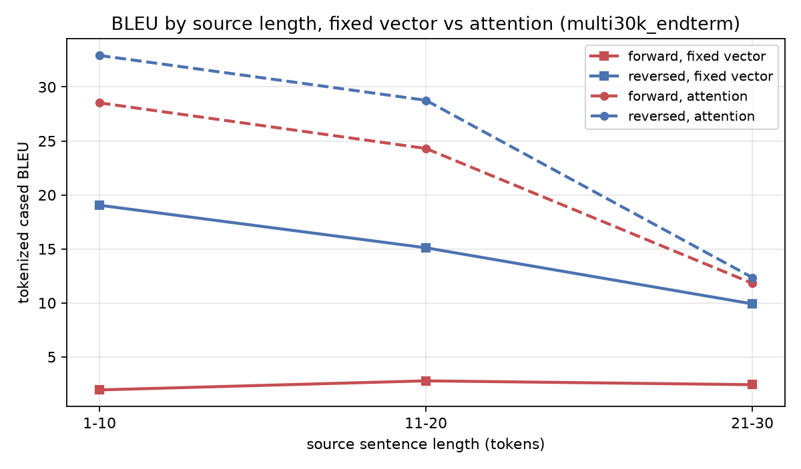
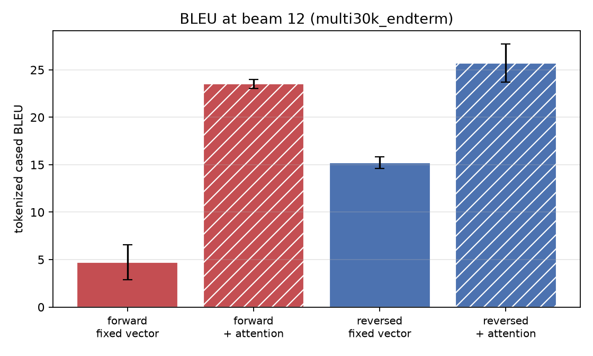

# End-term results - multi30k_endterm

> **Scale gap.** Multi30k (29k image captions), 2x256. Prepared with NO length-mismatch filtering. Pipeline validation plus the seed-controlled {forward,reversed} x {fixed vector, attention} grid - NOT the paper's corpus or test set.

The two arms share their corpus, vocabulary, seed, batch order, optimiser,
learning-rate schedule and gradient clipping. `attention: bahdanau` is the
only difference between them.

| direction | arm | beam | BLEU (tok, cased) | BLEU (detok) | test ppl | params | runs |
|---|---|---|---|---|---|---|---|
| forward | fixed vector | 12 | **4.72** ± 1.83 | 4.38 | 13.839 | 9.8M | 3 |
| forward | + attention | 12 | **23.51** ± 0.46 | 22.79 | 6.353 | 10.4M | 3 |
| reversed | fixed vector | 12 | **15.21** ± 0.63 | 14.85 | 9.048 | 9.8M | 3 |
| reversed | + attention | 12 | **25.73** ± 2.00 | 24.95 | 5.989 | 10.4M | 3 |

## What the arms say about the bottleneck

- reversed: fixed vector **15.21** -> attention **25.73** (**+10.52** BLEU).
- forward: fixed vector **4.72** -> attention **23.51** (**+18.80** BLEU).

- The reversal gap (reversed minus forward) is **+10.49** without attention and **+2.21** with it.
  Attention absorbs 79% of it. That is the paper's trick being made redundant: reversing the source shortens the distance between a source word and the decoder step that needs it, and attention removes the distance altogether.

### The shape of the length curve

This is the actual bottleneck claim: a single fixed vector should lose ground
as the source grows, and attention should not.

| source length | sentences | fixed vector | + attention | gain |
|---|---|---|---|---|
| 1-10 | 287 | 19.05 | 32.92 | **+13.87** |
| 11-20 | 659 | 15.11 | 28.76 | **+13.66** |
| 21-30 | 52 | 9.91 | 12.35 | **+2.43** |

- Fixed vector, 1-10 -> 21-30: 19.05 -> 9.91 (-9.13).
- Attention,    1-10 -> 21-30: 32.92 -> 12.35 (-20.57).

**The gain does NOT widen with source length** (+13.87 at 1-10 -> +2.43 at 21-30), and the attention arm falls off at least as fast as the fixed-vector arm (-20.57 vs -9.13). At this scale and on this corpus the length curve does NOT evidence the bottleneck; the arm-level gain above is real, but it is not explained by source length.

Treat the `21-30` row with care: it is 52 sentences, so its BLEU is noisy and the slope above rests largely on it.

## Figures

