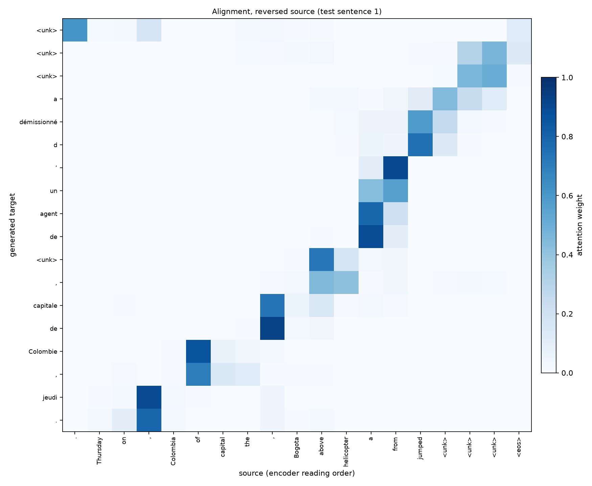
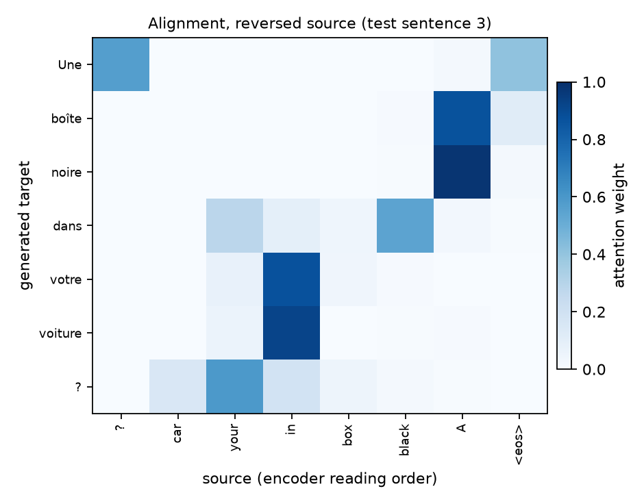
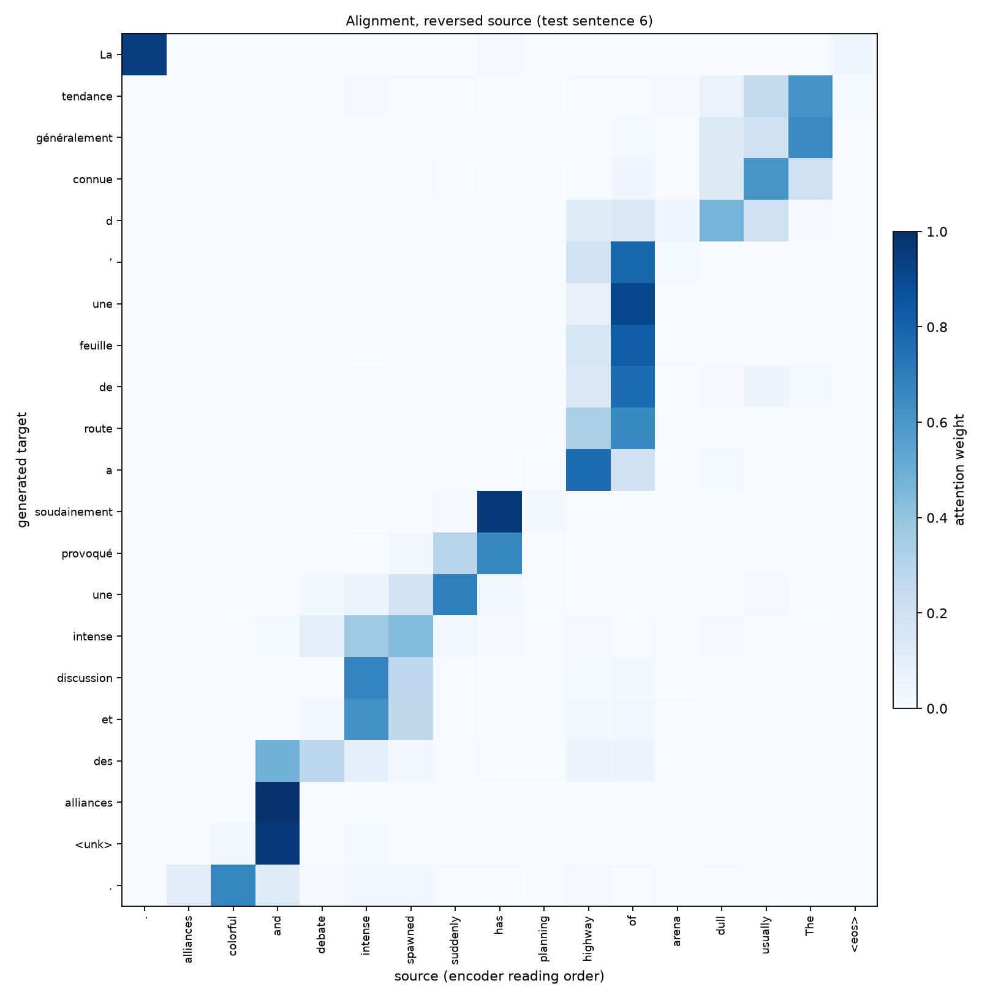
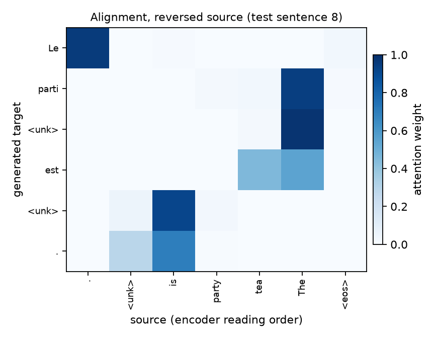
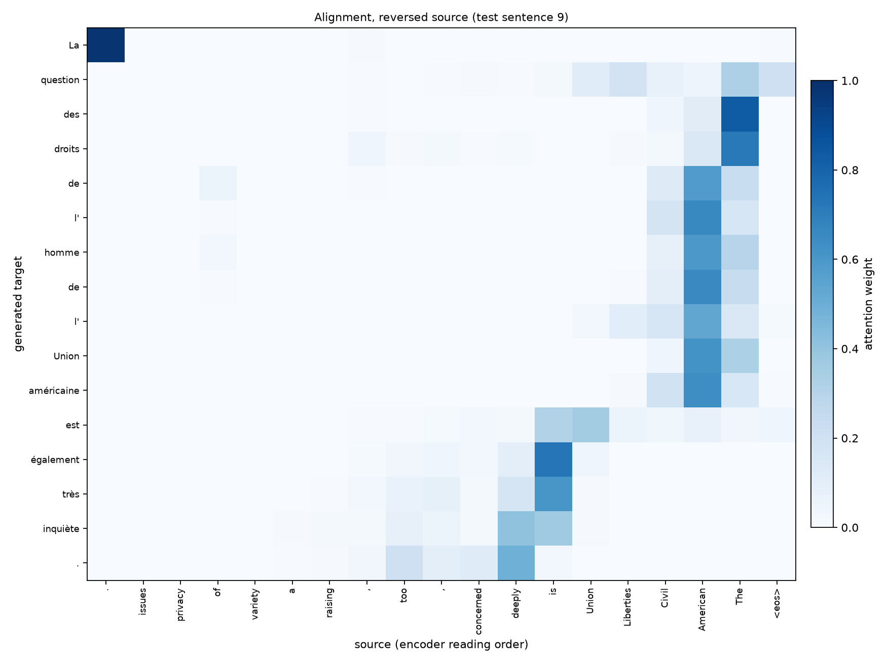
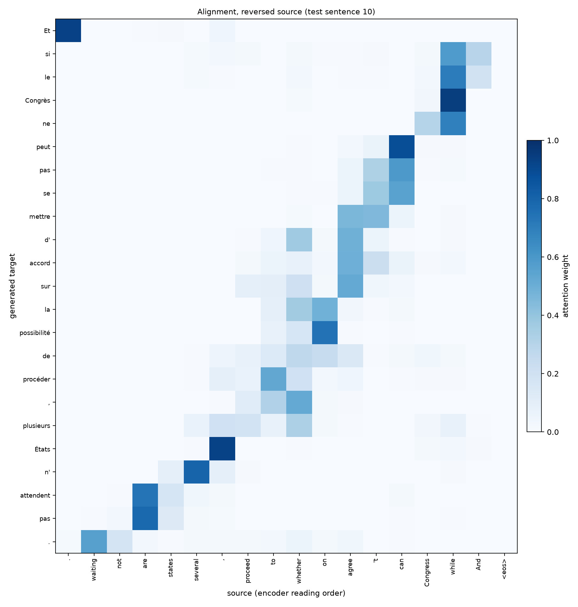

# Attention alignments (Bahdanau Fig. 3 analogue)

Model: `/Users/rubenstalin/ee5180-work/runs/wmt14_endterm/rev_attn_seed1/best.pt`, beam 12, reversed source.

The source axis is in **encoder reading order**. For a reversed model that is
right-to-left, so a faithful word-by-word alignment shows up as an anti-diagonal.
Alignments are over the model's own output, not the reference.

**Source**  <unk> <unk> <unk> jumped from a helicopter above Bogota , the capital of Colombia , on Thursday .

**Ours**    <unk> <unk> <unk> a démissionné d ’ un agent de <unk> , capitale de Colombie , jeudi .

---

**Source**  A black box in your car ?

**Ours**    Une boîte noire dans votre voiture ?

---

**Source**  The usually dull arena of highway planning has suddenly spawned intense debate and colorful alliances .

**Ours**    La tendance généralement connue d ’ une feuille de route a soudainement provoqué une intense discussion et des alliances <unk> .

---

**Source**  The tea party is <unk> .

**Ours**    Le parti <unk> est <unk> .

---

**Source**  The American Civil Liberties Union is deeply concerned , too , raising a variety of privacy issues .

**Ours**    La question des droits de l' homme de l' Union américaine est également très inquiète .

---

**Source**  And while Congress can 't agree on whether to proceed , several states are not waiting .

**Ours**    Et si le Congrès ne peut pas se mettre d' accord sur la possibilité de procéder , plusieurs États n' attendent pas .

---
