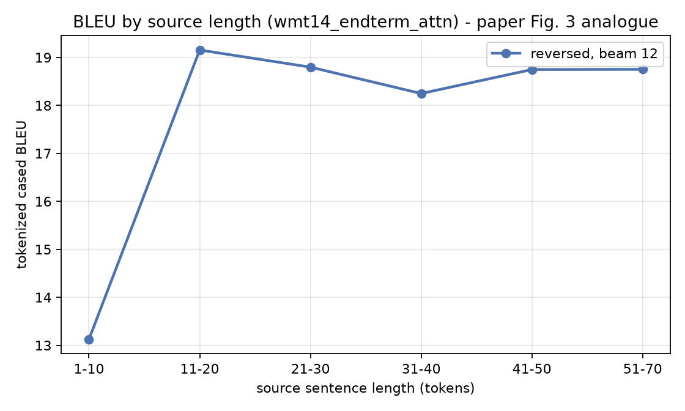
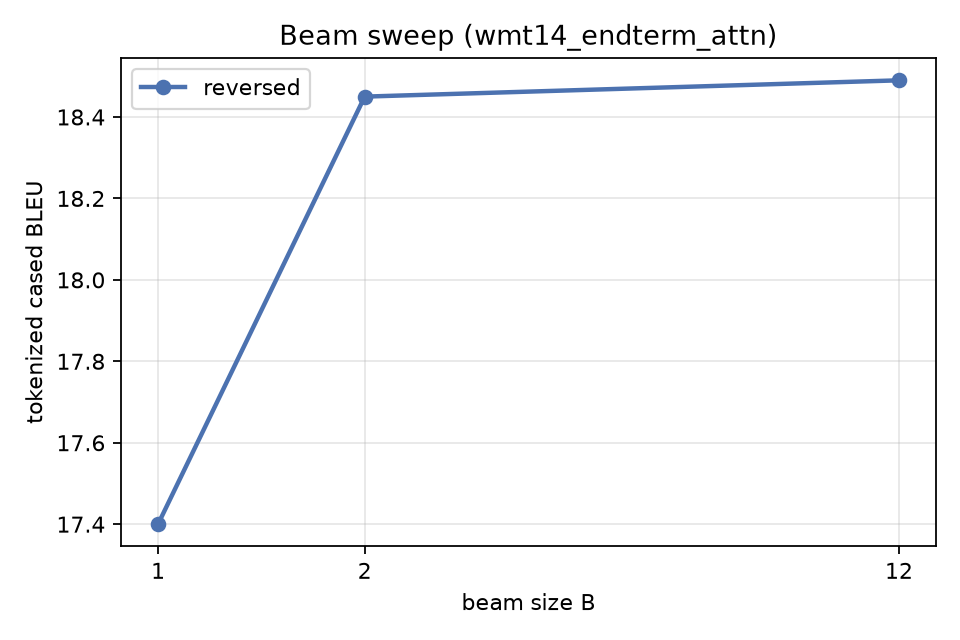
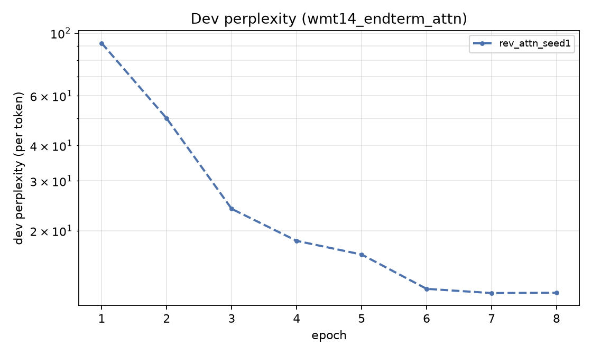

# Reproduction results - wmt14_endterm_attn

> **Scale gap.** 0.5M pairs vs the paper's 12M; 2x512 vs 4x1000; 32k/32k vocab vs 160k/80k. Prepared with NO length-mismatch filtering and a 100-token cap. Absolute BLEU is NOT comparable to Table 1 - the direction and shape of the effects are.

| Method | beam | our BLEU (tok, cased) | our BLEU (sacreBLEU detok) | our test ppl | paper BLEU |
|---|---|---|---|---|---|
| Single reversed LSTM | 1 | **17.40** | 13.29 | 10.69 | - |
| Single reversed LSTM | 2 | **18.45** | 14.54 | 10.69 | - |
| Single reversed LSTM | 12 | **18.49** | 14.99 | 10.69 | 30.59 |
- Beam: B=1 17.40, B=2 18.45, B=12 18.49 - B=2 recovers 96% of the B=1 -> B=12 gain, as in the paper (sec. 3.2).

## Figures

## Scoring signatures

- tokenized (multi-bleu.pl equivalent): `nrefs:1|case:mixed|eff:no|tok:none|smooth:exp|version:2.6.0`
- detokenized sacreBLEU: `nrefs:1|case:mixed|eff:no|tok:13a|smooth:exp|version:2.6.0`
