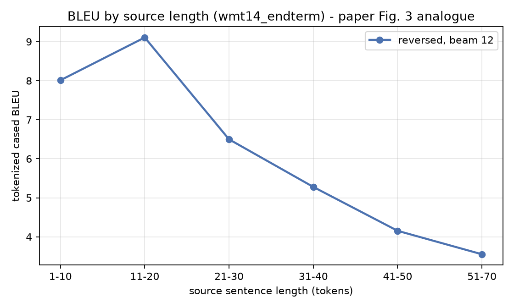
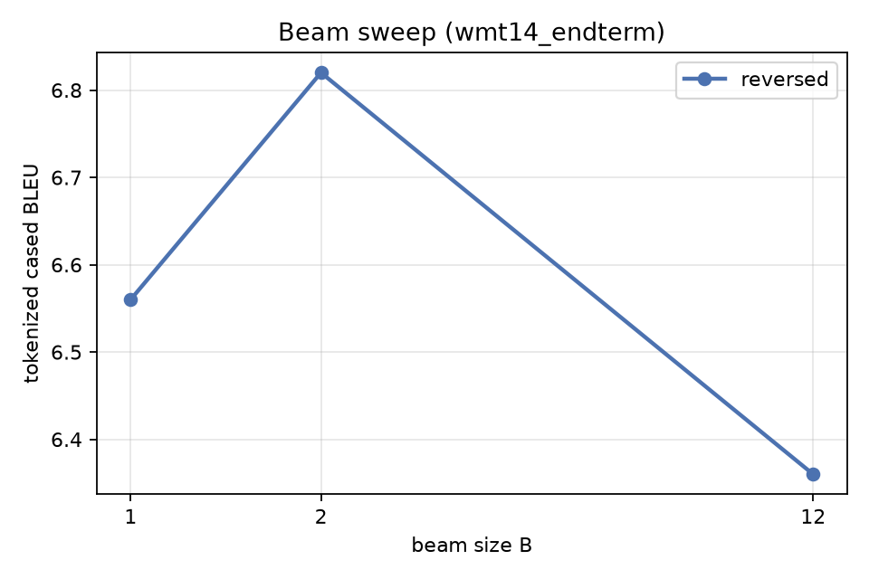
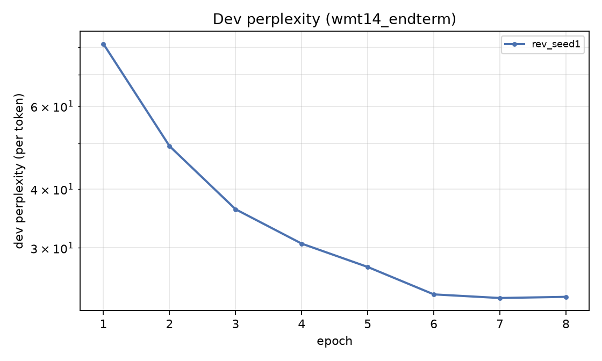

# Reproduction results - wmt14_endterm

> **Scale gap.** 0.5M pairs vs the paper's 12M; 2x512 vs 4x1000; 32k/32k vocab vs 160k/80k. Prepared with NO length-mismatch filtering and a 100-token cap. Absolute BLEU is NOT comparable to Table 1 - the direction and shape of the effects are.

| Method | beam | our BLEU (tok, cased) | our BLEU (sacreBLEU detok) | our test ppl | paper BLEU |
|---|---|---|---|---|---|
| Single reversed LSTM | 1 | **6.56** | 4.53 | 24.067 | - |
| Single reversed LSTM | 2 | **6.82** | 4.79 | 24.067 | - |
| Single reversed LSTM | 12 | **6.36** | 4.62 | 24.067 | 30.59 |
- Beam: B=1 6.56, B=2 6.82, B=12 6.36 - BLEU peaks at B=2 and falls by 0.46 at B=12, so the paper's monotone beam trend does NOT reproduce at our scale. A wider beam does find higher-probability hypotheses, but they are worse translations. Length normalisation removes the brevity penalty and makes BLEU worse still, so brevity is a symptom rather than the cause - see beam_ablation.md for the decomposition.

## Figures

## Scoring signatures

- tokenized (multi-bleu.pl equivalent): `nrefs:1|case:mixed|eff:no|tok:none|smooth:exp|version:2.6.0`
- detokenized sacreBLEU: `nrefs:1|case:mixed|eff:no|tok:13a|smooth:exp|version:2.6.0`
