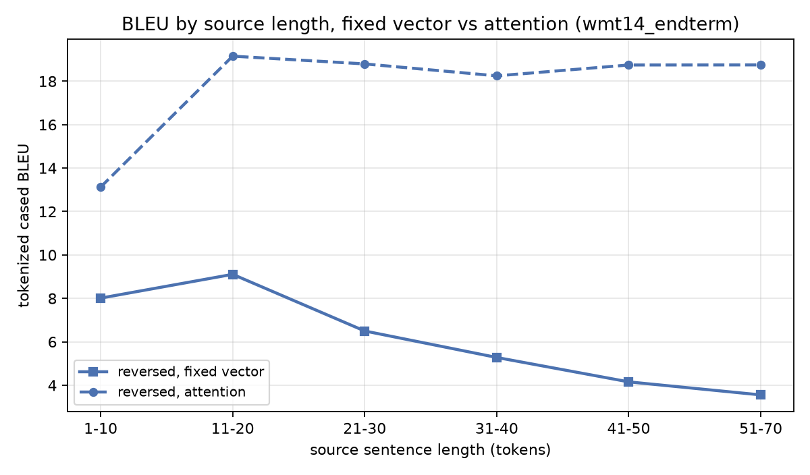
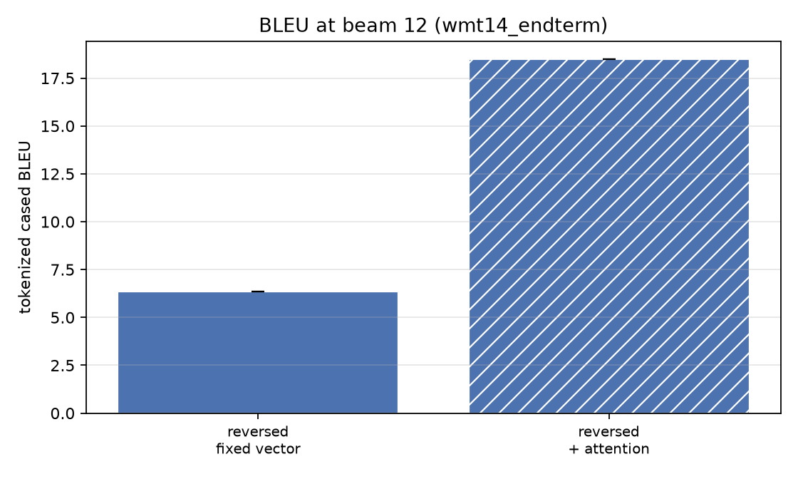

# End-term results - wmt14_endterm

> **Scale gap.** 0.5M pairs vs the paper's 12M; 2x512 vs 4x1000; 32k/32k vocab vs 160k/80k. Prepared with NO length-mismatch filtering and a 100-token cap. Absolute BLEU is NOT comparable to Table 1 - the direction and shape of the effects are.

The two arms share their corpus, vocabulary, seed, batch order, optimiser,
learning-rate schedule and gradient clipping. `attention: bahdanau` is the
only difference between them.

| direction | arm | beam | BLEU (tok, cased) | BLEU (detok) | test ppl | params | runs |
|---|---|---|---|---|---|---|---|
| reversed | fixed vector | 12 | **6.36** | 4.62 | 24.067 | 57.6M | 1 |
| reversed | + attention | 12 | **18.49** | 14.99 | 10.690 | 59.9M | 1 |

## What the arms say about the bottleneck

- reversed: fixed vector **6.36** -> attention **18.49** (**+12.13** BLEU).

### The shape of the length curve

This is the actual bottleneck claim: a single fixed vector should lose ground
as the source grows, and attention should not.

| source length | sentences | fixed vector | + attention | gain |
|---|---|---|---|---|
| 1-10 | 405 | 8.01 | 13.12 | **+5.11** |
| 11-20 | 954 | 9.11 | 19.15 | **+10.05** |
| 21-30 | 832 | 6.50 | 18.80 | **+12.30** |
| 31-40 | 535 | 5.28 | 18.25 | **+12.97** |
| 41-50 | 194 | 4.15 | 18.75 | **+14.59** |
| 51-70 | 80 | 3.55 | 18.75 | **+15.20** |

- Fixed vector, 1-10 -> 51-70: 8.01 -> 3.55 (-4.46).
- Attention,    1-10 -> 51-70: 13.12 -> 18.75 (+5.63).

The gain widens with source length (+5.11 at 1-10 -> +15.20 at 51-70), which is the bottleneck claim: the longer the source, the more a single fixed vector costs.

Treat the `51-70` row with care: it is 80 sentences, so its BLEU is noisy and the slope above rests largely on it.

## Figures

