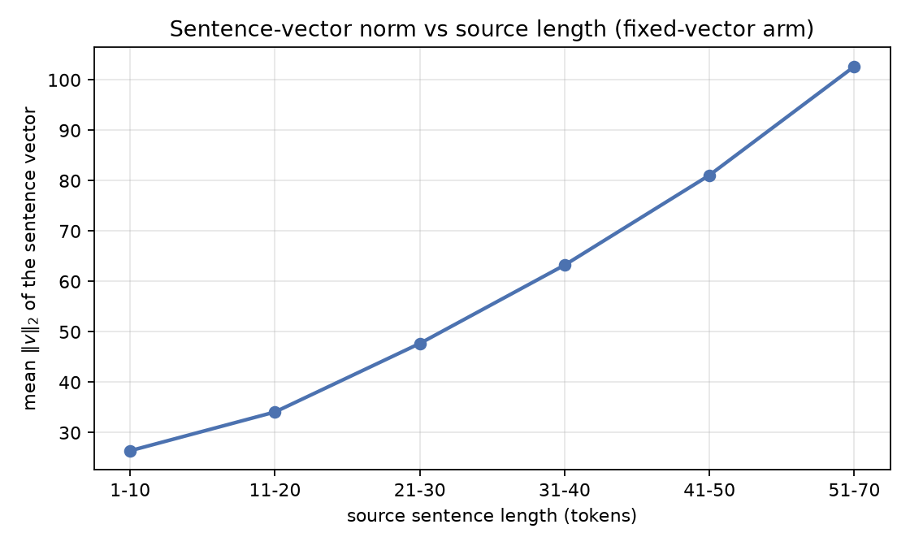

# Direct probes of the fixed-vector bottleneck

Split: `test`, reversed source. No beam search is
involved in any number on this page -- these are the models' own likelihoods.

## Per-token perplexity by source length

| source length | n | fixed vector | + attention | ratio |
|---|---|---|---|---|
| 1-10 | 405 | 20.428 | 13.270 | 0.650 |
| 11-20 | 954 | 17.785 | 9.572 | 0.538 |
| 21-30 | 832 | 21.662 | 9.949 | 0.459 |
| 31-40 | 535 | 27.956 | 11.270 | 0.403 |
| 41-50 | 194 | 32.970 | 11.604 | 0.352 |
| 51-70 | 80 | 39.158 | 12.674 | 0.324 |

A ratio that falls as the buckets get longer means attention helps *more*
on long sentences -- which is the bottleneck claim, stated in likelihood
rather than in BLEU.

## Sentence-vector saturation

The fixed-length vector is 2,048 real numbers (num_layers x hidden x 2, the analogue of the paper's 8,000), and it carries
the entire source sentence regardless of how long that sentence is.

| source length | n | mean &#124;&#124;v&#124;&#124; |
|---|---|---|
| 1-10 | 405 | 26.3991 |
| 11-20 | 954 | 34.0908 |
| 21-30 | 832 | 47.6918 |
| 31-40 | 535 | 63.2498 |
| 41-50 | 194 | 81.0987 |
| 51-70 | 80 | 102.6732 |

